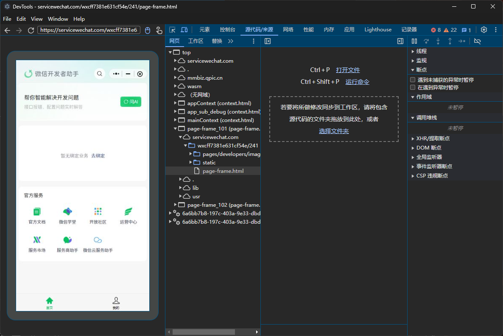
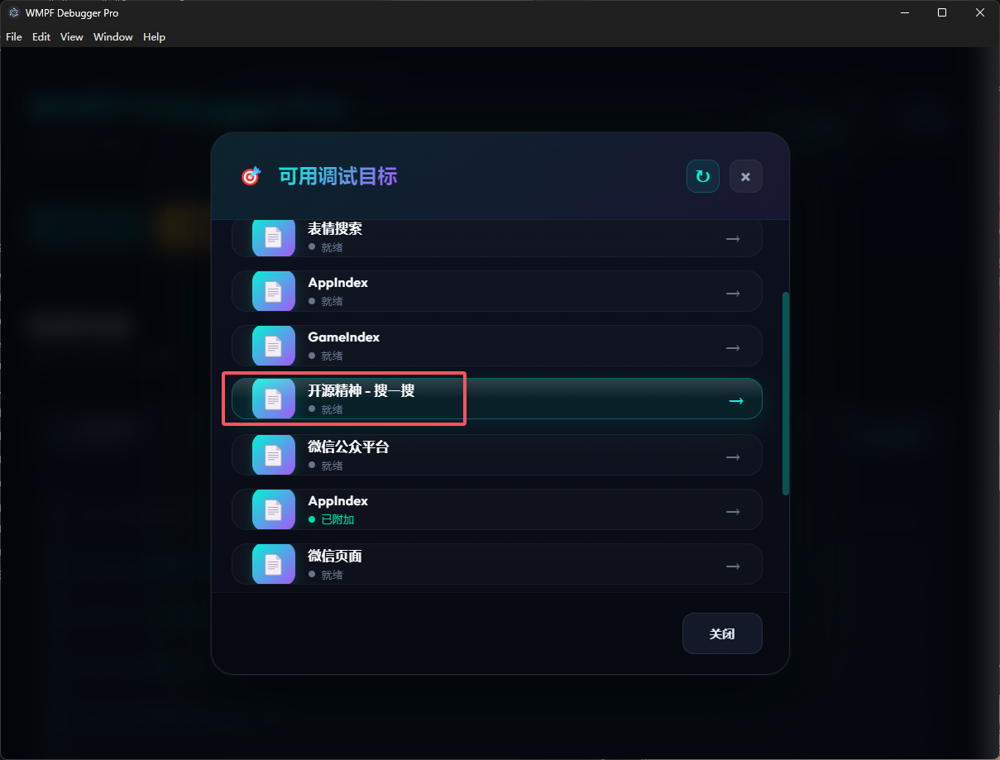
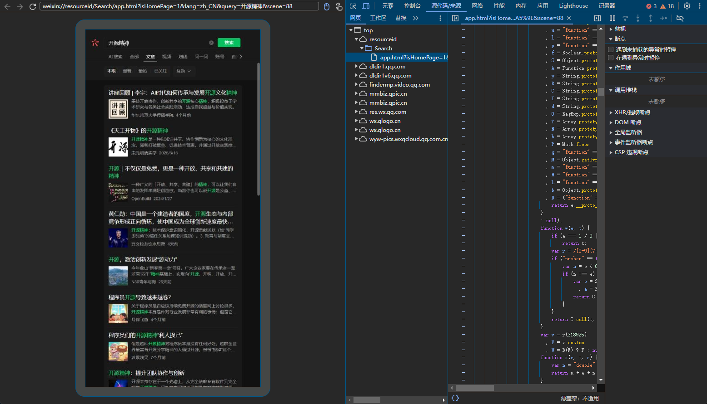

# WMPFDebugger-kiss

<div align="center">


**微信小程序 & 内置浏览器网页调试工具**

一键启动，自动注入 Frida Hook，支持小程序和 H5 网页的 Chrome DevTools 调试

</div>

---

## 功能特性

- **小程序调试** — 自动检测小程序启动，自动弹出 Chrome DevTools 调试窗口
- **H5 网页调试** — 通过「可用目标」列表选择并附加到微信内置浏览器页面自动打开进行调试
- **进程监控** — 实时监控 WeChatAppEx 进程，自动处理连接与断开
- **日志过滤** — 支持按等级过滤日志（仅提醒/报错 或 全部）
- **GUI 界面** — Electron 桌面应用，操作简单直观

## 界面预览

### 小程序调试窗口



### 可用目标列表

点击「可用目标」按钮后，会列出所有可调试的页面：



### H5 网页调试

选择目标后，自动打开网页调试窗口：



## 环境要求

- **操作系统**：Windows 10/11
- **Node.js**：>= 18.x
- **微信 PC 版**：已安装并登录
- **Frida**：随依赖自动安装

## 安装

### 1. 克隆项目

```bash
git clone https://github.com/Bai-Ye-Yi/WMPFDebugger-kiss.git
cd WMPFDebugger-kiss
```

### 2. 安装依赖

```bash
npm install
```

> 安装过程会自动执行 `npm run build` 编译 TypeScript 源码。

### 3. 运行

```bash
npm run ui
```

或双击 `运行.vbs` 启动（无终端窗口）。

## 使用方法

### 小程序调试

1. 启动应用后，点击 **「启动调试器」** 按钮
2. 等待日志显示 **Frida 已就绪**
3. 在微信中打开任意小程序
4. 调试窗口会 **自动弹出**
5. 如果没有自动弹出，关闭小程序重新打开，不能直接刷新小程序，必须关闭重新打开，或查看日志排查原因

### H5 网页调试

1. 先按上述步骤通过小程序进入调试会话（**必须先开小程序**）
2. 在微信中打开目标网页
3. 点击 **「可用目标」** 按钮
4. 在弹出的列表中选择要调试的网页，点击即可附加调试窗口
5. **注意**：小程序及其调试窗口不要关闭，可以最小化到后台，否则已连接的 H5 网页调试也会断开

## 支持的微信版本

程序通过 Frida Hook 注入 `WeChatAppEx.exe`，不同版本需要对应的偏移地址配置。

当前已支持的版本（`frida/config/` 目录）：

| 版本号 | 配置文件 |
|--------|----------|
| 11581 | `addresses.11581.json` |
| 11633 | `addresses.11633.json` |
| 13331 | `addresses.13331.json` |
| 13341 | `addresses.13341.json` |
| 13487 | `addresses.13487.json` |
| 13639 | `addresses.13639.json` |
| 13655 | `addresses.13655.json` |
| 13871 | `addresses.13871.json` |
| 13909 | `addresses.13909.json` |
| 14161 | `addresses.14161.json` |
| 14199 | `addresses.14199.json` |
| 14315 | `addresses.14315.json` |
| 16133 | `addresses.16133.json` |
| 16203 | `addresses.16203.json` |
| 16389 | `addresses.16389.json` |
| 16467 | `addresses.16467.json` |
| 16771 | `addresses.16771.json` |
| 16815 | `addresses.16815.json` |
| 16965 | `addresses.16965.json` |
| 17037 | `addresses.17037.json` |
| 17071 | `addresses.17071.json` |
| 17127 | `addresses.17127.json` |
| 18055 | `addresses.18055.json` |
| 18151 | `addresses.18151.json` |
| 18787 | `addresses.18787.json` |
| 18891 | `addresses.18891.json` |
| 18955 | `addresses.18955.json` |
| 19027 | `addresses.19027.json` |
| 19201 | `addresses.19201.json` |

### 新增版本适配

支持新版本只需添加 JSON 配置文件，无需修改代码：

1. 获取新版本的三个 Hook 偏移地址
2. 在 `frida/config/` 下创建 `addresses.<版本号>.json`：

```json
{
    "Version": <版本号>,
    "LoadStartHookOffset": "0xXXXXXXX",
    "CDPFilterHookOffset": "0xXXXXXXX",
    "SceneOffsets": [offset1, offset2, offset3]
}
```

3. 重新启动调试器即可自动加载新配置

## 故障排除

| 问题 | 解决方案 |
|------|----------|
| 提示 WeChatAppEx.exe not found | 确保微信已运行，并打开过至少一个小程序 |
| 提示 version config not found | 当前微信版本未适配，需要添加对应的偏移配置文件 |
| 小程序调试窗口未自动弹出 | 关闭小程序重新打开，或查看日志排查原因 |
| H5 网页无法调试 | 确保先通过小程序建立调试会话，再打开网页 |
| Frida 注入失败 | 尝试以管理员权限运行 |

## 致谢

- [WMPFDebugger](https://github.com/evi0s/WMPFDebugger) — 核心调试框架
- [WMPFDebugger UI](https://github.com/gugugudo/WMPFDebugger) — UI 基础设计

## License

[GPL-2.0](LICENSE)
